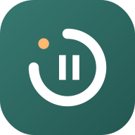

# StopScroll

**Scroll to unwind. Stay in control.**

An Android app that lets you enjoy your feeds, then calls time on them, gently.
No account, no internet access, no guilt.

---

Scrolling is a real way to rest. The problem is never the first ten minutes. It is the hour that
follows without you noticing. StopScroll keeps the good part. You choose how long a break in an
app lasts. When it is over, StopScroll closes the app and gives you a real pause before the next
one.

## Why it helps

| | |
| --- | --- |
| **3 h 46 min** | Average time per day that internet users spend using the internet on mobile devices. [DataReportal, Digital 2025 Global Overview Report](https://datareportal.com/reports/digital-2025-global-overview-report) (GWI data) |
| **2 h 21 min** | Time the typical internet user spends using social media each day. [Same report](https://datareportal.com/reports/digital-2025-global-overview-report) |
| **16 %** | In a randomized experiment, access to a screen-time limit feature "reduced use in periods 2–5 by an average of 22 minutes per day, or 16 percent relative to the Control group". The authors estimate that "self-control problems cause 31 percent of social media use". [Allcott, Gentzkow and Song, *Digital Addiction*, American Economic Review, 2022](https://www.aeaweb.org/doi/10.1257/aer.20210867) ([working paper](https://www.nber.org/papers/w28936)) |
| **57 %** | A short interruption before opening a chosen app "decreased users' actual opening of target apps by 57% after six consecutive weeks". [Grüning, Riedel and Lorenz-Spreen, PNAS, 2023](https://doi.org/10.1073/pnas.2213114120) |

Limits you set for yourself work. StopScroll makes them effortless to keep.

## How it works

1. **You set a time to unwind.** Pick an app and how long you want to enjoy it, for example
   5 minutes. Leave the app and come back later: the remaining time waits for you.
2. **A gentle heads-up.** 30 seconds before the end, a small message appears at the top of the
   screen for 4 seconds. No sound, no vibration.
3. **Time for a pause.** When the time is up, StopScroll shows a calm screen and the app takes a
   break, for example 10 minutes. Opening it during the break sends you back to your home screen.
4. **Need to finish something?** Tap **+30 s** to get 30 more seconds. The next pause is twice as
   long. Each further +30 s doubles it again. Finishing a message is fine. Endless "one more
   minute" is not.

When the pause is over, a full new allowance starts.

## Features

- One rule per app, each with its own time to unwind, pause duration and on/off switch.
- Your remaining time is kept across openings, restarts and reboots.
- A calm time-up screen with the app icon, the pause length and the **+30 s** option.
- App icons everywhere, suggestions for the usual feeds, and search in the app picker.
- Quick presets (1, 5, 10, 15, 30 min of use; 5, 10, 20, 30 min or 1 h of pause) or any value in seconds.
- Light and dark themes, following the system or your choice.
- Interface in French.

## Privacy

Everything stays on your phone.

- **No internet access.** The app declares no `INTERNET` permission, so it cannot send anything.
- **No account, no analytics, no ads.**
- **No backup of your data** to the cloud (`allowBackup` is off).
- StopScroll only learns **which app is in the foreground**. It never reads screen text, takes
  screenshots, or sees what you type or browse.
- It lists only launchable apps, through a scoped `<queries>` declaration instead of
  `QUERY_ALL_PACKAGES`.

## The accessibility permission, honestly

StopScroll needs Android's accessibility service to know when you open a chosen app and to send
you back to the home screen. It is the only permission the app asks for. There is no overlay
permission, no usage access, no notifications, no device administrator and no root.

Android shows a strong warning when you enable any accessibility service, because such a service
*could* read the screen. StopScroll's service listens to window changes only. Android requires the
window-content capability for a service to list the open windows. StopScroll uses it only to read
which app owns each window, never what is inside. The source code is here for you to check.

The app enforces nothing until you turn the service on yourself, and you can turn it off at any
time in the settings. StopScroll is a self-control tool you choose, not a lock.

## Install

**From a release.** Download the APK from the
[Releases](https://github.com/Jilanos/StopScroll/releases) page, open it on your phone and allow
installs from that source when asked.

**From source.** See [docs/DEVELOPMENT.md](docs/DEVELOPMENT.md).

Then, in StopScroll:

1. Follow the setup card: **Settings → Accessibility → Installed apps → StopScroll**, and turn
   it on.
2. If the switch is greyed out, the app came from outside a store and Android restricts it. Open
   **Settings → Apps → StopScroll → ⋮ → Allow restricted settings**, then try again
   ([Android help](https://support.google.com/android/answer/12623953)).
3. Back in StopScroll, the top card reads *StopScroll veille*. Add your first app.

Requires Android 8.0 or later.

## Good to know

- StopScroll sends you to your home screen. It does not uninstall, force-stop or hide apps.
- Changing the system clock changes when a pause ends.
- Split-screen, picture-in-picture, work profiles and the web versions of apps are not covered.
- There is no PIN on purpose. You stay in charge.

## Roadmap

- English interface.
- Daily summary of time saved.
- Schedules, such as no limit on weekends.

## For developers

Build, tests, architecture, runtime rules and the device checklist live in
[docs/DEVELOPMENT.md](docs/DEVELOPMENT.md).
