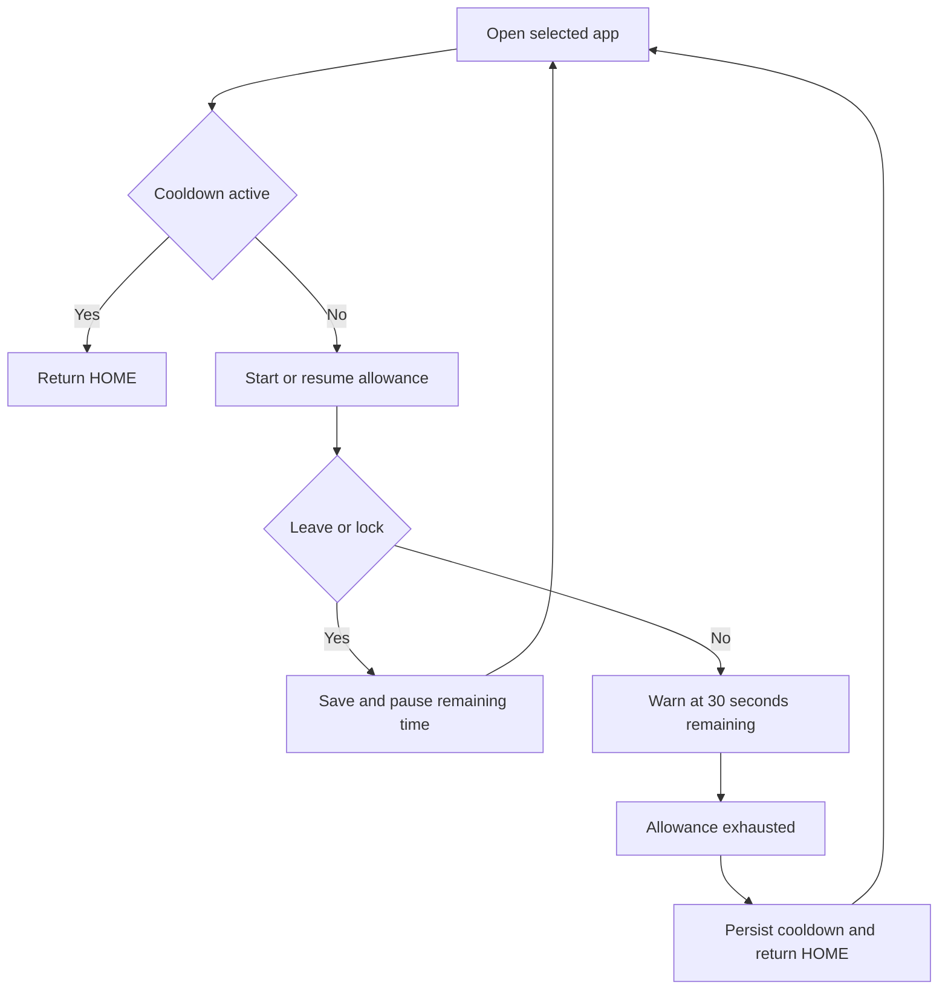

## prod_001_stopscroll_minimal_android_self_control_app - StopScroll minimal Android self-control app
> Date: 2026-09-19
> Status: Proposed
> Related request: `req_000_stopscroll_android_mvp_for_per_opening_app_limits`
> Related backlog: `item_001_bootstrap_android_app_and_persistent_app_rules`, `item_002_implement_deterministic_session_and_cooldown_engine`, `item_003_connect_accessibility_detection_warning_and_home_enforcement`, `item_004_validate_apk_and_document_installation_and_permissions`
> Related task: `task_001_deliver_stopscroll_android_mvp_apk`
> Related architecture: (none yet)
> Reminder: Update status, linked refs, scope, decisions, success signals, and open questions when you edit this doc.
> Indicators reviewed: 2026-09-19 16:20:07

# Overview
Help a user interrupt prolonged app sessions and enforce a short break, initially validated with Instagram, through a locally configured Android app.

# Goals
- Deliver a reproducible debug APK and a short understandable permission setup.
- Keep the experience to app selection, duration configuration, service status and enforcement.
- Make session and cooldown behavior explicit, deterministic and testable.
- Store data locally and require no account, server or network.

# Non-goals
- Play Store submission, billing, accounts, cloud sync, analytics or daily reports.
- Anti-uninstall, PIN enforcement, device-owner management or protection against a user disabling accessibility.
- Daily cumulative budgets, scheduling, complex rules or reminders outside active sessions.
- Guaranteed coverage of split-screen, picture-in-picture, cloned apps, work profiles, browser Instagram or Instagram Lite in the initial validation.
- A foreground-service framework, polling loop, Usage Access permission or exact alarms unless demonstrated necessary and scoped explicitly.

# Scope and guardrails
- In: one Kotlin/Compose Android app, selectable per-app rules, retained foreground allowance, 30-second warning, HOME enforcement, persisted cooldown and an installable APK with setup instructions.
- Validate Instagram on the user's Pixel 8 and record its installed Android version. Other launchable apps remain selectable.
- Observe only package/window transitions required for enforcement; store configuration and runtime state locally.
- Accessibility is user-enabled and can be disabled by the user. HOME returns to the launcher; it does not force-stop a target or prevent its initial display.

# Key product decisions
- Confirmed: resume remaining usage after leaving, French UI, visual warning above the target, cooldown surviving reboot, freely editable settings and manual APK installation.
- The allowance pauses on another ordinary app or screen lock; only its exhaustion starts cooldown. Warning state spans all openings in that allowance cycle.
- Default proposal: 5 minutes usage and 10 minutes cooldown, editable independently for each app. The user has not supplied alternative durations.
- Engineering choices and edge cases: logics/scaffold/android-mvp-decisions.md. Confirmed decisions in this brief and request govern implementation; the scaffold JSON is the initial generation input, not a replacement for subsequent document refinement.

# Success signals
- A clean checkout builds an APK the user can install and enable with the README instructions.
- On the Pixel 8, Instagram consumes the saved allowance, warns near its end, returns HOME and remains subject to HOME enforcement until cooldown expires.
- Exit/reopen, duplicate events, independent app rules, restart and reboot scenarios have recorded results; configuration does not silently reset.
- The UI remains limited to selecting apps, editing durations and understanding whether monitoring is active.

# References
- Product back-reference: `req_000_stopscroll_android_mvp_for_per_opening_app_limits`
- Task back-reference: `task_001_deliver_stopscroll_android_mvp_apk`
